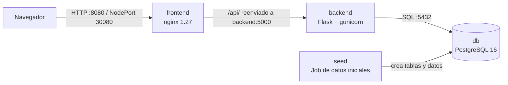
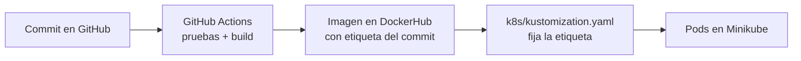

# Arquitectura

## Componentes y flujo de datos

1. El navegador abre la pagina (frontend, nginx).
2. Cuando el usuario guarda una meta, el navegador llama a `/api/metas`. nginx reenvia todo lo que empiece por `/api/` al backend.
3. El backend valida, calcula la cuota con la formula de anualidad de valor futuro y la guarda en PostgreSQL.
4. Para buscar, el frontend llama a `/api/metas/{id}` y el backend lee de la base de datos.
5. El `seed` corre una sola vez: crea las tablas y carga el admin, la tabla maestra y los datos de ejemplo.

## Cadena de entrega (de codigo a Kubernetes)

## Repositorios
| Parte | Repositorio |
|---|---|
| Monorepo (compose, k8s, e2e, docs) | https://github.com/JoseM1715/entrega2 |
| Backend | https://github.com/JoseM1715/entrega2-backend |
| Frontend | https://github.com/ValenMJ-02/entrega2-frontend |

## Decisiones tecnicas y su razon
| Decision | Por que |
|---|---|
| Frontend, backend y BD separados | Cada parte se construye, prueba y despliega sola |
| Imagenes Docker | El mismo artefacto corre en cualquier maquina |
| PostgreSQL con volumen persistente | Los datos sobreviven al reinicio de la base de datos |
| Contrasenas en un Secret de Kubernetes | Nunca quedan en git ni en las imagenes |
| Probes y limites de recursos | Kubernetes detecta fallas y reinicia solo; ningun pod acapara memoria |
| Pruebas unitarias y Playwright | Detectan errores antes de desplegar |

## Limites (hay que decirlos con honestidad)
- La web todavia no tiene inicio de sesion (el usuario `admin` existe, falta el login).
- La tasa de interes es fija (0,75 % mensual).
- La base de datos tiene una sola replica (sin alta disponibilidad).
- No usamos GitOps (Argo CD): el despliegue lo hace `kubectl apply -k`.
